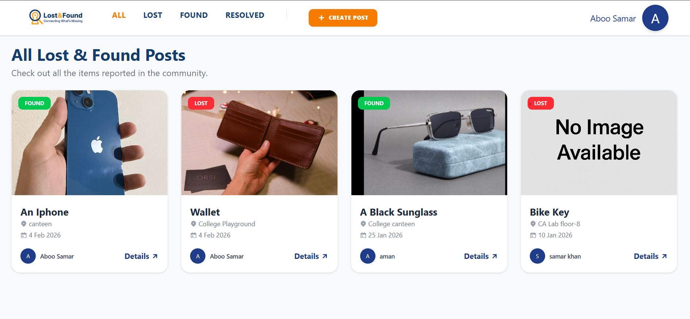
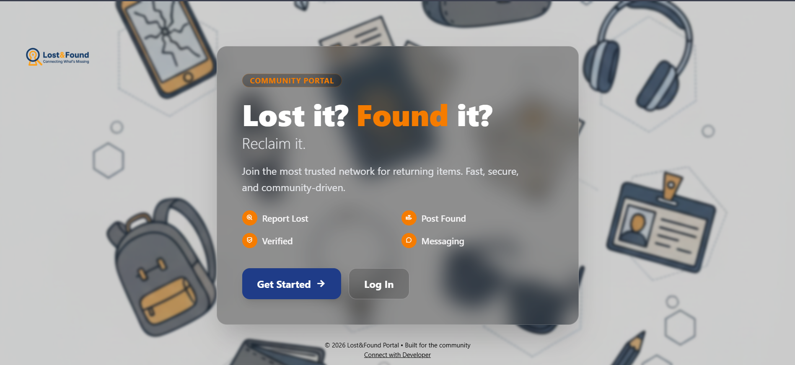
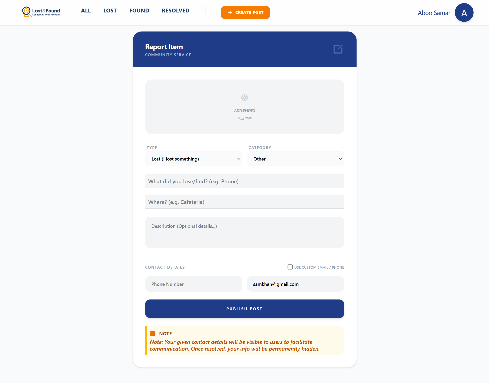
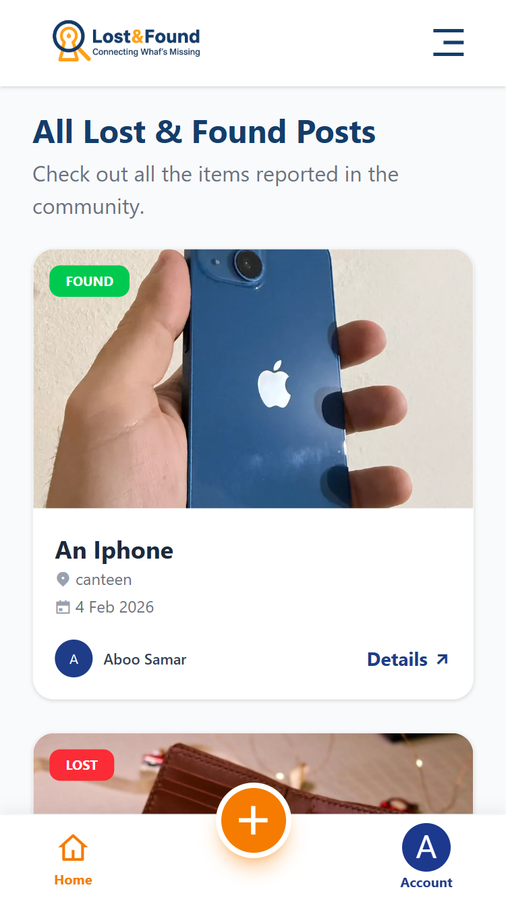

# Lost&Found 🧭

A full‑stack MERN application for managing lost and found posts with secure authentication, responsive UI, and cloud image storage.

---

## 🚀 Features

- **Authentication**

  - Secure signup/login with **JWT** and **bcrypt** hashing
  - Access & refresh tokens with **HTTP‑only cookies**
  - Signup using **email or phone number**

- **Posts**

  - View all lost & found posts
  - Filter posts by **Lost / Found / Resolved**
  - Manage **My Posts**: mark as resolved, edit, delete
  - Create new posts with image upload (**Cloudinary**)

- **Profile**

  - Fetch and view user profile data
  - Update profile information

- **UI/UX**
  - Responsive design with **TailwindCSS**
  - Navigation bar with filters
  - Smooth state management using **Redux**
  - Skeleton loaders & polished error handling

---

## 🛠 Tech Stack

- **Frontend:** React, Redux, TailwindCSS
- **Backend:** Node.js, Express.js
- **Database:** MongoDB
- **Authentication:** JWT, bcrypt, cookies
- **Image Storage:** Cloudinary

---

## ⚙️ Installation & Setup

1. **Clone the repository**
   ```bash
   git clone https://github.com/yourusername/lost-and-found.git
   cd lost-and-found
   ```

2.Install dependencies

# Backend

cd server
npm install

# Frontend

cd ../client
npm install

3.Environment variables
Create a .env file in the server folder with:
MONGO_URI=your_mongodb_connection_string
JWT_SECRET=your_jwt_secret
CLOUDINARY_CLOUD_NAME=your_cloud_name
CLOUDINARY_API_KEY=your_api_key
CLOUDINARY_API_SECRET=your_api_secret

4.Run the project

# Backend

cd server
npm run dev

# Frontend

cd ../client
npm start

## 📸 Screenshots

### Home Page





### Create Post



### mobile view


